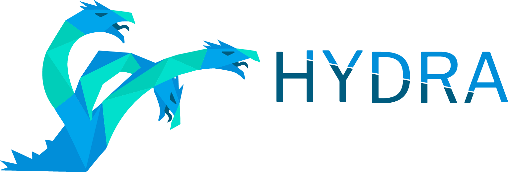
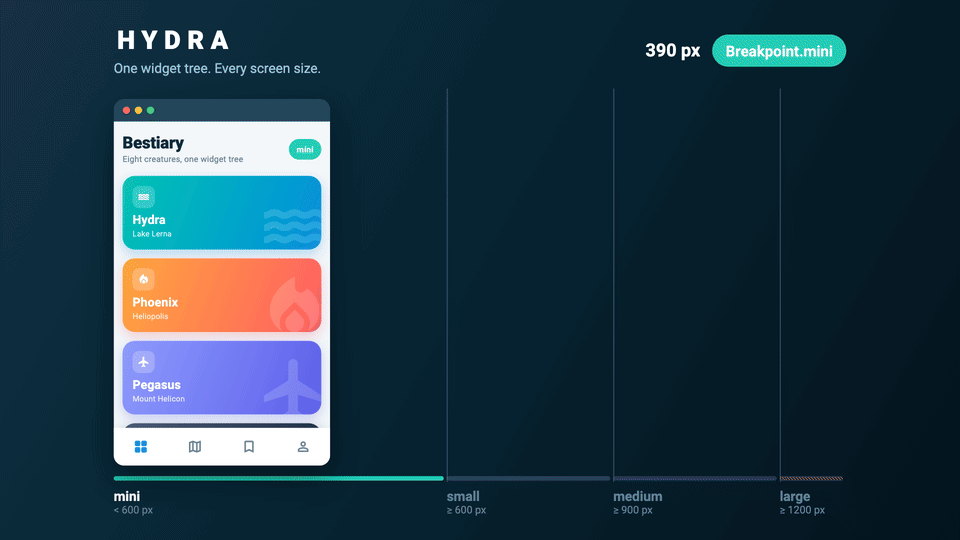

# Hydra

[](https://pub.dev/packages/hydra)
[](https://github.com/igoriuz/hydra/actions/workflows/ci.yml)
[](https://codecov.io/gh/igoriuz/hydra)
[](LICENSE)
[](https://pub.dev/packages/very_good_analysis)

Responsive layouts are like the Hydra of Greek mythology - cut off one screen size and two more appear. Phone, tablet, foldable, desktop, ultrawide... every time you think you've handled them all, a new head grows.

Hydra tames the beast. Describe what changes at up to four breakpoints and let it pick the right variant - with zero additional dependencies beyond Flutter itself.

<p align="center">
  
</p>

<p align="center">
  The animation is the <a href="example">example app</a>: one widget tree, resized from 390 to 1320 px.
</p>

## Highlights

- **Responsive widgets** - swap entire widgets per breakpoint, optionally animated
- **Responsive values** - adapt padding, font sizes, colors or any type `T`
- **Building blocks** - visibility, grid and builder widgets for the common cases
- **Configure once** - one `HydraScope` instead of a `behaviour` on every widget
- **Smart fallbacks** - you don't need a variant for every breakpoint
- **Zero dependencies** - only Flutter SDK, nothing else
- **100% test coverage** - every line, every head

## Installation

```bash
flutter pub add hydra
```

```dart
import 'package:hydra/hydra.dart';
```

## At a glance

| You want to... | Use |
|---|---|
| show a different widget per breakpoint | [`HydraWidget`](#responsive-widgets) |
| pick a value per breakpoint | [`HydraValue<T>` / `context.hydra<T>()`](#responsive-values) |
| build one tree from the breakpoint | [`HydraBuilder` / `Breakpoint.current`](#the-current-breakpoint) |
| show something only on some screens | [`HydraVisibility`](#visibility) |
| change the number of grid columns | [`HydraGrid`](#grid) |
| set breakpoints once for the whole app | [`HydraScope`](#configure-once-with-hydrascope) |

## Responsive Widgets

Use `HydraWidget` to display different widgets based on the current breakpoint:

```dart
HydraWidget(
  mini: const PhoneLayout(),
  medium: const TabletLayout(),
  large: const DesktopLayout(),
)
```

Hydra selects the best match for the current screen width. If no exact match exists, it falls back to the nearest available alternative - `small` shows `TabletLayout` here.

### Animated transitions

By default the widgets are swapped instantly. Pass a `transition` to animate the change:

```dart
HydraWidget(
  transition: const HydraTransition.fade(),
  mini: const PhoneLayout(),
  large: const DesktopLayout(),
)
```

| Transition | Effect |
|---|---|
| `HydraTransition.fade()` | Cross-fades the old and the new widget |
| `HydraTransition.scale()` | Fades and scales the new widget in |
| `HydraTransition(builder: ...)` | Your own `AnimatedSwitcher` transition builder |

All of them take a `duration` (300 ms by default) and a `curve`.

## Responsive Values

Use the `BuildContext` extension when you need a value instead of a whole widget:

```dart
@override
Widget build(BuildContext context) {
  return Padding(
    padding: EdgeInsets.all(context.hydra<double>(mini: 8, large: 32)),
    child: Text(
      'Hello',
      style: TextStyle(
        fontSize: context.hydra<double>(mini: 14, medium: 16, large: 20),
      ),
    ),
  );
}
```

Or keep the value around as a `HydraValue<T>` and resolve it later:

```dart
final padding = HydraValue<double>(mini: 8, small: 16, large: 32);

@override
Widget build(BuildContext context) {
  return Padding(
    padding: EdgeInsets.all(padding.resolve(context)),
    child: content,
  );
}
```

Works with any type - `double`, `EdgeInsets`, `TextStyle`, `Color`, or your own types.

## The Current Breakpoint

`HydraBuilder` hands the active breakpoint to a builder, for a single widget tree that adapts in place:

```dart
HydraBuilder(
  builder: (context, breakpoint) {
    return Padding(
      padding: EdgeInsets.all(breakpoint == Breakpoint.mini ? 8 : 24),
      child: Text('Current: ${breakpoint.name}'),
    );
  },
)
```

Outside of a builder, ask for it directly:

```dart
final breakpoint = Breakpoint.current(context);

if (breakpoint.index >= Breakpoint.medium.index) {
  showSideNavigation();
}
```

## Visibility

`HydraVisibility` shows its child only within a range of breakpoints. Both bounds are inclusive and optional; a hidden child is not built.

```dart
// Side navigation on tablets and desktops ...
HydraVisibility(
  visibleFrom: Breakpoint.medium,
  child: const SideNavigation(),
)

// ... and a bottom bar everywhere else.
HydraVisibility(
  visibleUntil: Breakpoint.small,
  child: const BottomBar(),
)
```

Pass a `replacement` to show something else instead of nothing.

## Grid

`HydraGrid` is a `GridView.count` whose column count depends on the breakpoint:

```dart
HydraGrid(
  mini: 1,
  small: 2,
  medium: 3,
  large: 4,
  mainAxisSpacing: 16,
  crossAxisSpacing: 16,
  children: cards,
)
```

`padding`, `childAspectRatio`, `shrinkWrap` and `physics` are passed through to the grid.

## Breakpoints

Default breakpoints: **600** (small), **900** (medium), **1200** (large). Everything below 600 is considered `mini`.

```dart
// Custom breakpoints
HydraWidget(
  behaviour: const HydraBehaviour(
    breakpointSmall: 480,
    breakpointMedium: 768,
    breakpointLarge: 1024,
  ),
  small: mobileLayout(),
  medium: tabletLayout(),
  large: desktopLayout(),
)
```

Every Hydra widget and value accepts a `behaviour`.

### Presets

| Constructor | small / medium / large | Source |
|---|---|---|
| `HydraBehaviour()` | 600 / 900 / 1200 | Hydra default |
| `HydraBehaviour.material()` | 600 / 840 / 1200 | [Material Design 3](https://m3.material.io/foundations/layout/applying-layout) |
| `HydraBehaviour.bootstrap()` | 576 / 768 / 992 | [Bootstrap 5](https://getbootstrap.com/docs/5.3/layout/breakpoints/) `sm` / `md` / `lg` |
| `HydraBehaviour.tailwind()` | 640 / 768 / 1024 | [Tailwind CSS](https://tailwindcss.com/docs/responsive-design) `sm` / `md` / `lg` |
| `HydraBehaviour.cupertino()` | 428 / 768 / 1024 | Apple device widths: iPhone Pro Max (428), iPad portrait, iPad landscape |

### Options

| Constructor | Description |
|---|---|
| `HydraBehaviour()` | Default: orientation-aware, prefers larger fallback |
| `HydraBehaviour.preferSmaller()` | Falls back to smaller alternative instead of larger |
| `HydraBehaviour.noOrientation()` | Uses shortest side regardless of orientation |

By default, Hydra uses `MediaQuery.sizeOf(context).width` which changes when the device rotates. Set `isOrientationAware: false` (or use `HydraBehaviour.noOrientation()`) to use the shortest side instead - the layout stays consistent regardless of rotation. The presets accept both flags as well.

## Configure Once With HydraScope

Instead of passing the same `behaviour` everywhere, put a `HydraScope` above your app:

```dart
HydraScope(
  behaviour: const HydraBehaviour.material(),
  child: MaterialApp(...),
)
```

Everything below it - `HydraWidget`, `HydraValue`, `context.hydra`, `HydraBuilder`, `HydraVisibility`, `HydraGrid` and `Breakpoint.current` - uses the scoped behaviour. A `behaviour` passed directly still wins.

## How It Works

1. **Breakpoint detection** - determines the current breakpoint from screen width
2. **Exact match** - looks for a widget or value registered at that breakpoint
3. **Nearest fallback** - if no exact match, picks the closest available alternative (prefers larger by default, configurable via `isSmallerScreenPreferred`)

## Example

The [example app](example) is the one from the animation above. Run it and resize the window:

```bash
cd example
flutter run -d chrome
```

## License

MIT
